# Hardware

## 1 EduArt Sensor Boards

The table below shows the current versions of the EduArt sensor boards that can be used with the EduArt Sensor Ring library.
The TMF8829 is currently available only on the Edu Minipanel, as an alternative to the VL53L8CX.

<div align="center">
<table>
	<tr>
		<th scope="col">Feature</th>
		<th scope="col">Edu Headlight</th>
		<th scope="col">Edu Taillight</th>
		<th scope="col">Edu Sidepanel</th>
		<th scope="col">Edu Minipanel (VL53L8CX)</th>
		<th scope="col">Edu Minipanel (TMF8829)</th>
	</tr>
	<tr>
		<th scope="row">Board</th>
		<td style="text-align:center">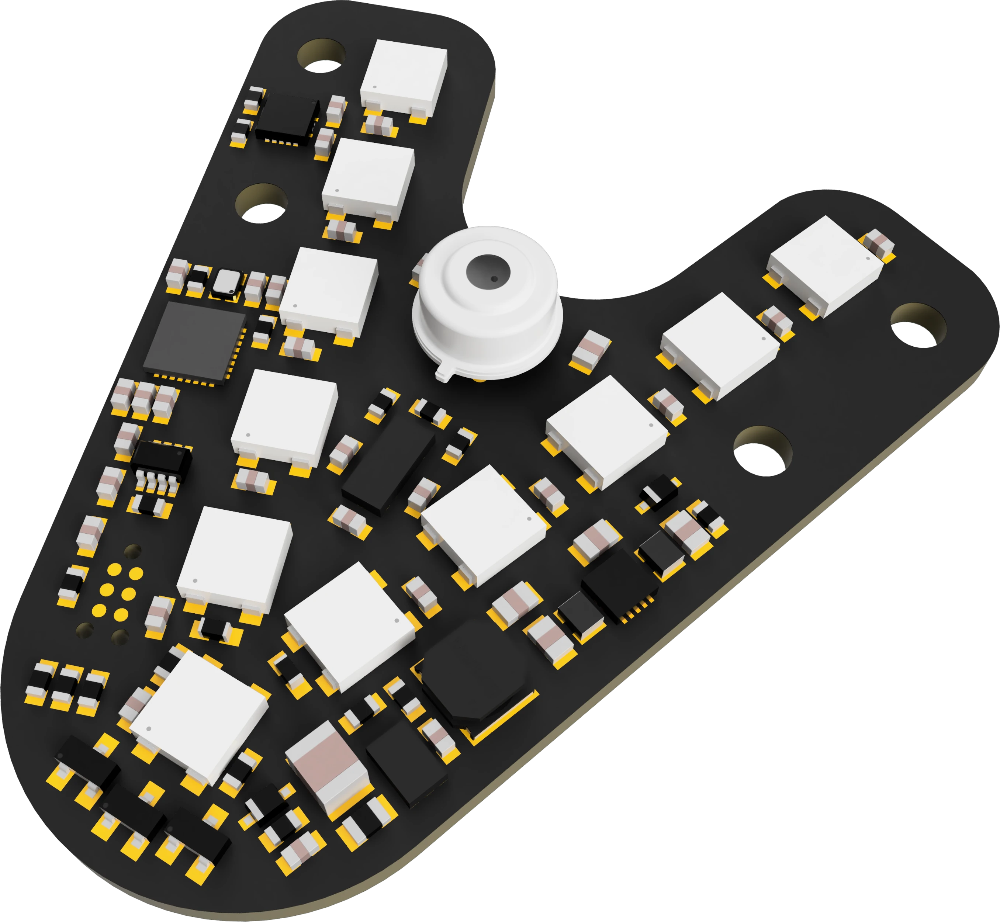</td>
		<td style="text-align:center">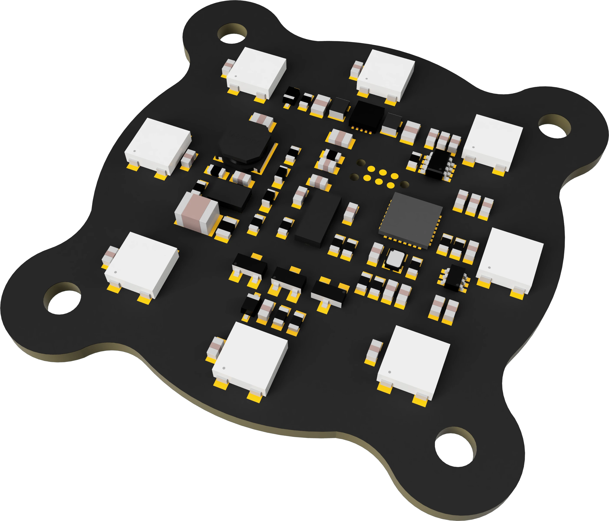</td>
		<td style="text-align:center">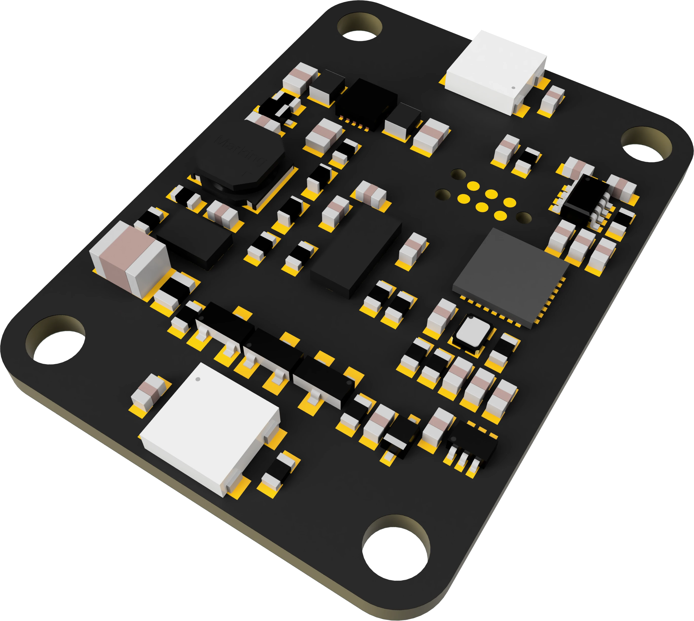</td>
		<td style="text-align:center">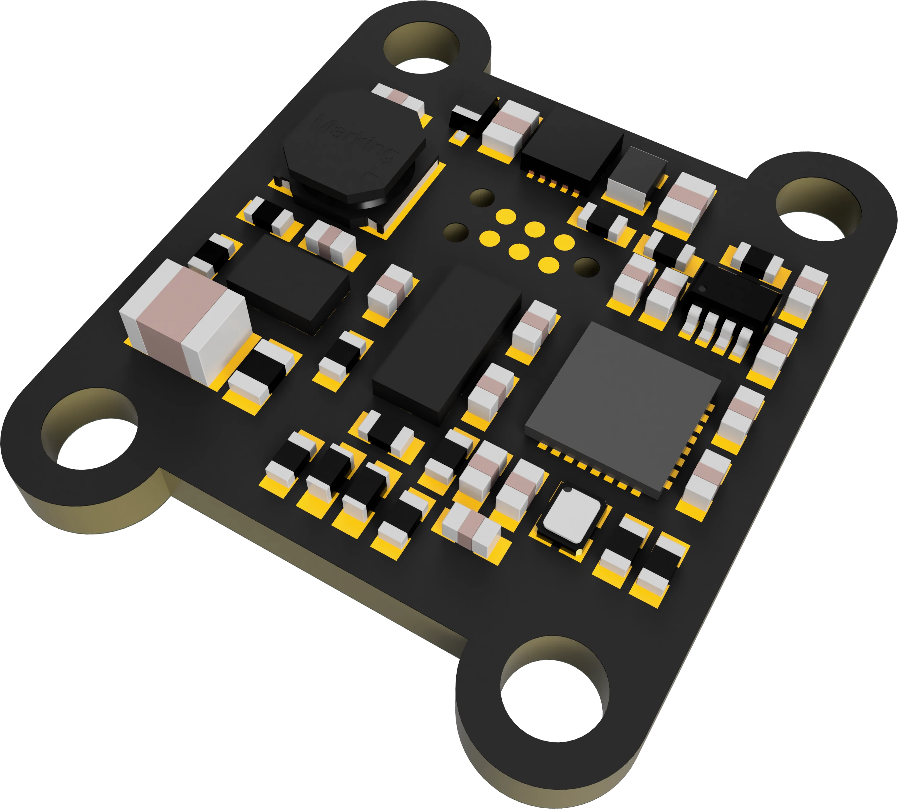</td>
		<td style="text-align:center"></td>
	</tr>
	<tr>
		<th scope="row">Application</th>
		<td>EduBot headlight</td>
		<td>EduBot taillight</td>
		<td colspan="3">General purpose sensor board</td>
	</tr>
	<tr>
		<th scope="row">Time-of-Flight sensor</th>
		<td colspan="4">ST VL53L8CX (8 × 8)</td>
		<td>ams OSRAM TMF8829 (8 × 8 up to 48 × 32)</td>
	</tr>
	<tr>
		<th scope="row">Thermal sensor</th>
		<td>Optional Heimann HTPA32x32d</td>
		<td colspan="4">None</td>
	</tr>
	<tr>
		<th scope="row">Addressable RGB LEDs</th>
		<td>11</td>
		<td>2</td>
		<td>2</td>
		<td>None</td>
		<td>None</td>
	</tr>
	<tr>
		<th scope="row">Board dimensions</th>
		<td>61 × 55 mm</td>
		<td>48 × 48 mm</td>
		<td>38 × 28 mm</td>
		<td colspan="2">28 × 24 mm</td>
	</tr>
	<tr>
		<th scope="row">Interface</th>
		<td colspan="5">CAN FD</td>
	</tr>
	<tr>
		<th scope="row">Input voltage</th>
		<td colspan="5">6 V - 65 V DC</td>
	</tr>
</table>
</div>

Both Minipanel variants use the same representative board image because their appearance is almost identical.


## 2 Main Components of the Sensor Boards

### 2.1 ST VL53L8CX Time of Flight sensor

The ST VL53L8CX is a 3D multi-zone Time-of-Flight sensor available on all Edu Sensor Board types. It returns a grid of 8 × 8 individual distance values per measurement.
The Edu Minipanel is also available with the TMF8829 instead of the VL53L8CX.
The measurements from all Time-of-Flight sensors in the EduArt Sensor Ring are combined in a single large point cloud whose resolution depends on the number of connected sensors and their configured measurement resolutions.
<a href="https://www.st.com/en/imaging-and-photonics-solutions/vl53l8cx.html">[Product Website]</a>

The key features of the sensor according to the manufacturers [datasheet](https://www.st.com/resource/en/datasheet/vl53l8cx.pdf) are:

- Ranging up to 400 cm
- Measurements with 8 × 8 resolution at 15 Hz
- Square Field-of-View with 65° diagonal opening angle (45° vertical and horizontal)
- Accuracy of ±8% or better in most cases (refer to datasheet)

<div align="center">
<table style="border: none;">
	<tr>
		<td style="text-align:center">
			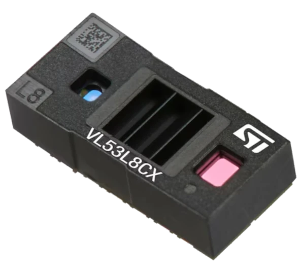<br>
			The ST VL53L8CX Time-of-Flight sensor
		</td>
		<td style="text-align:center">
			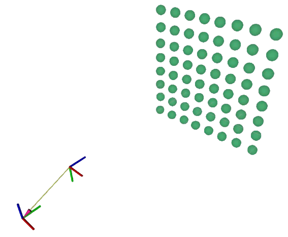<br>
			Visualization of a VL53L8CX measurement
		</td>
	</tr>
</table>
</div>

### 2.2 ams OSRAM TMF8829 Time of Flight sensor

The ams OSRAM TMF8829 is a 3D multi-zone direct Time-of-Flight sensor offered as an alternative to the VL53L8CX on the Edu Minipanel.
It returns a grid of distance values with configurable resolution from 8 × 8 up to 48 × 32 pixels.
Like the VL53L8CX, its measurements are included in the Sensor Ring point cloud.
<a href="https://ams-osram.com/products/sensor-solutions/direct-time-of-flight-sensors-dtof/ams-tmf8829-48x32-multi-zone-time-of-flight-sensor">[Product Website]</a>

The key features of the sensor according to the manufacturer are:

- Ranging up to 1100 cm, depending on the measurement mode and conditions
- Configurable 8 × 8, 16 × 16, 32 × 32, and 48 × 32 measurement resolutions
- Field-of-View with 80° diagonal opening angle (approximately 68° horizontal and 53° vertical)
- Multiple target detection within each measurement zone

The library defaults to 8 × 8 resolution. See [TMF8829 device parameters](04_parameters.md#tmf8829) for resolution modes, measurement settings, and result frame size limits.

<div style="text-align:center">
<br>
The ams OSRAM TMF8829 Time-of-Flight sensor
</div>

### 2.3 Heimann HTPA32x32d Thermophile Array

The Edu Headlight sensors boards can be delivered with an optional Heimann HTPA32x32d is an all-in-one integrated thermal imaging sensor.
It returns a thermal image with temperature values for each pixel.
In addition the Sensor Ring library converts the temperature image into a false color image for better visualization.
<a href="https://www.heimannsensor.com/32x32">[Product Website]</a>

The key features of the sensor according to the manufacturers [datasheet](https://cdn.website-editor.net/s/156d2965ff764637aaea150903bb0161/files/uploaded/Overview-Datasheet-HTPA_32x32d_Rev17..pdf?Expires=1766828974&Signature=ayPse7nhwOi4OYhHHa6741axk7JH3HkDCt~zpfZMiv6pI2rj3XoPFwJDAJweLorboxOXewXBjHCR59WJvzPGT~2e5WX2BuvGyUfPGh9jrswpmV50EMBWNfxNtui0V-iMOzQ6QjD3R-LqB5xKXP8lZzYJDB1rGqcShdnoX~wQBuVsr~jNtsRjvCfAlx4lyAZpBpHEwnJOkuhz-ypo9rExuUukEd-2pSWV55nhWJ0IbBE3urLdm-vdfxkbuYoDUiQCkNmIIuPWVxUj18UStx15E~7cHYqQn4W66fPocQcgeLt0~iFnX2jZTNg9l45IoMbIg6cAqt39CYmAFtrFN9z5-w__&Key-Pair-Id=K2NXBXLF010TJW) are:

- 32 × 32 pixel resolution
- Measures temperatures between -20°C and >1000°C
- Available with different optics
- Developed for person detection

<div align="center">
<table style="border: none;">
	<tr>
		<td style="text-align:center; padding: 20px;">
			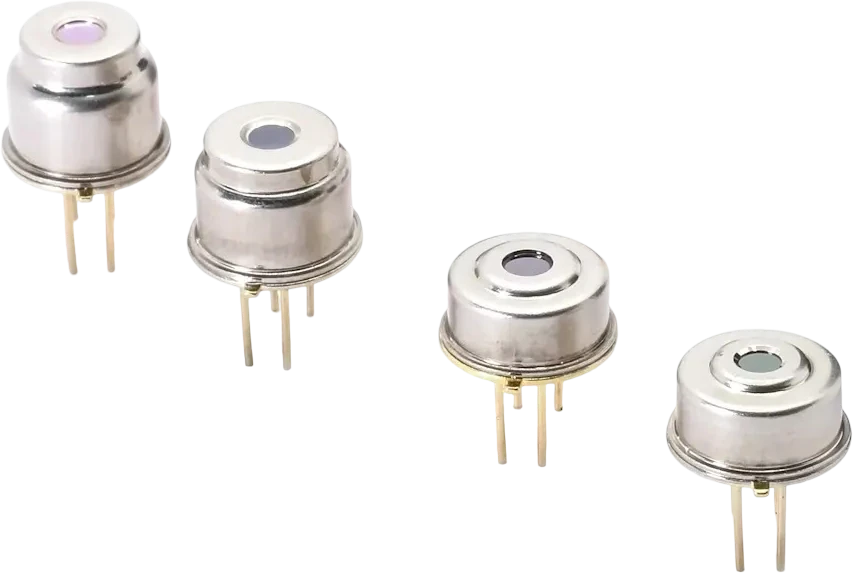<br>
			The Heimann HTPA32x32d Thermophile Arrays with different optics
		</td>
		<td style="text-align:center; padding: 20px;">
			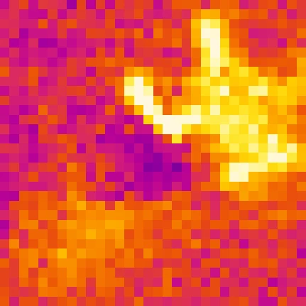<br>
			Visualization of a HTPA32x32d measurement
		</td>
	</tr>
</table>
</div>


### 2.4 Individually Addressable RGB LEDs

Some Sensor Boards come with individually addressable RGB LEDs.
The LEDs can either be set to predefined color animations or can be set individually through the library.
<a href="https://www.inolux-corp.com/details.php?i=230#SMD-LED">[Product Website]</a>

<div style="text-align:center">
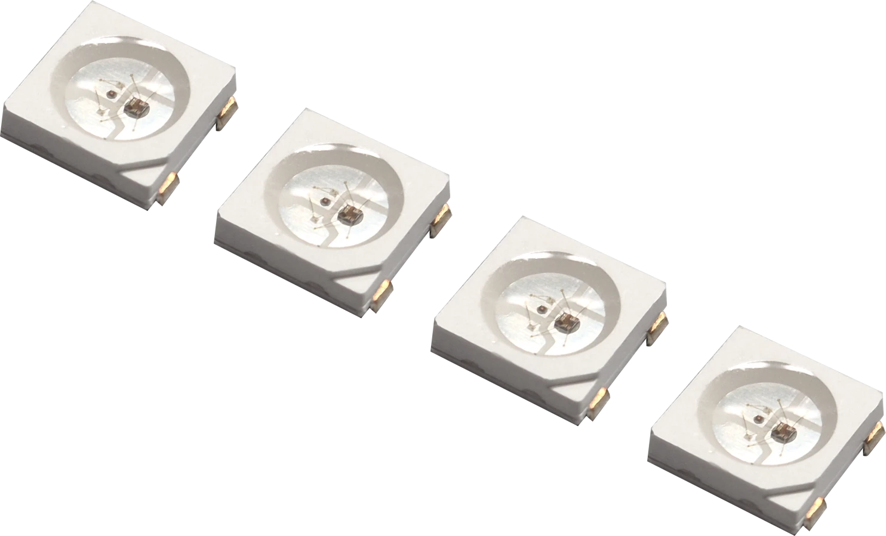<br>
Individually addressable RGB LEDs
</div>


## 3 Supported Communication Interfaces

### 3.1 SocketCAN 

The Sensor Ring library implements the Linux specific SocketCAN interface to communicate with the sensors.
The SocketCAN interface can be used on most Linux machines by using a CAN FD USB adapter with Linux Kernel support or through a SPI to CAN FD adapter for embedded computers like a Raspberry Pi.

To use the SocketCAN interface type you need to connect a compatible CAN adapter to your computer and start the interface.

```sh
sudo ip link set can0 up type can bitrate 1000000 dbitrate 5000000 fd on
```

> ⚠️ The EduArt sensors have a fixed baud rates of 1 Mbps nominal and 5 Mbps for the data. Make sure your interface matches these rates.

Use the `ifconfig` or `ip addr` command to verify that the CAN interfaces are up and running. In this example we have the CAN interface `can0` up and running.

```sh
$ ifconfig
can0: flags=193<UP,RUNNING,NOARP>  mtu 72
      unspec 00-00-00-00-00-00-00-00-00-00-00-00-00-00-00-00  txqueuelen 10  (UNSPEC)
      RX packets 0  bytes 0 (0.0 B)
      RX errors 0  dropped 0  overruns 0  frame 0
      TX packets 0  bytes 0 (0.0 B)
      TX errors 0  dropped 0 overruns 0  carrier 0  collisions 0
      device interrupt 170
```


### 3.1.1 EduArt Raspberry Pi Adapter

EduArt provides a [RaspberryPi adapter shield](https://eduart-robotik.com/products/kinematicskit-kim/) that provides two independent CAN FD interfaces reserved for the sensors.
Refer to [this guide](https://github.com/EduArt-Robotik/edu_robot/blob/main/documentation/setup/raspberry/setup_raspberry.md) on how to set up a Raspberry Pi with the EduArt adapter shield.
After the setup of the shield you should see three running CAN interfaces with the `ifconfig` or `ip addr` command.

<div style="text-align:center">
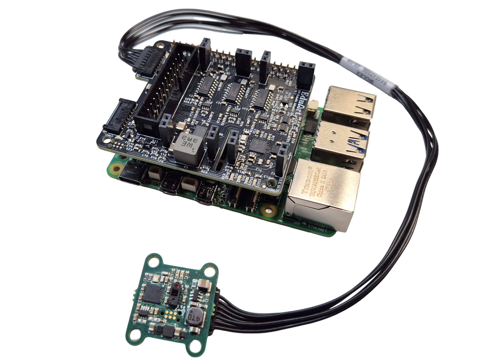<br>
A Raspberry Pi with the EduArt adapter shield and one minipanel sensor board.
</div>

### 3.1.2 SocketCAN USB Adapter

The SocketCAN interface can also be used on most Linux machines with a CAN FD adapter with Linux Kernel support like the [candleLightFD](https://linux-automation.com/de/products/candlelight-fd.html) adapter.
These adapters are super easy to use:

1. Connect the adapter via USB to your computer.
2. Run `sudo ip link set can0 up type can bitrate 1000000 dbitrate 5000000 fd on` to start the interface.
3. Verify that the interface is running with the `ifconfig` or `ip addr` command.
4. Optional: Create a UDEV rule that automatically starts the interface when the adapter is connected.

```sh
sudo bash -c 'echo "ACTION==\"add\", SUBSYSTEM==\"usb\", ATTR{idVendor}==\"1d50\", ATTR{idProduct}==\"606f\", RUN+=\"/usr/local/bin/start_can0.sh\"" > /etc/udev/rules.d/50-candlelight.rules'
sudo bash -c 'echo -e "#!/bin/bash\n\n# Wait for CAN interface to appear (up to 5 seconds)\nfor i in {1..10}; do\n    if ip link show can0 >/dev/null 2>&1; then\n        break\n    fi\n    sleep 0.5\ndone\n\n# Bring up CAN FD\n/usr/sbin/ip link set can0 up type can bitrate 1000000 dbitrate 5000000 fd on" > /usr/local/bin/start_can0.sh'
sudo chmod +x /usr/local/bin/start_can0.sh
sudo udevadm control --reload-rules
sudo udevadm trigger
```

<div style="text-align:center">
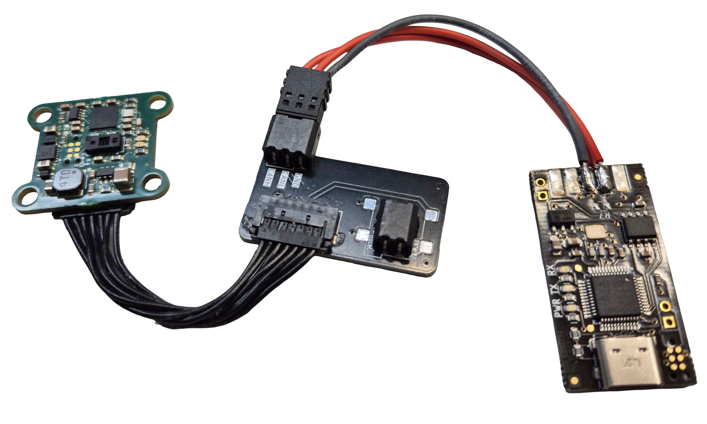<br>
A CandlightFD CAN FD to USB adapter with one minipanel sensor board.
</div>

### 3.2 USBtingo USB Adapter  

In addition to the Linux only SocketCAN interface the Sensor Ring library also implements the cross platform USBtingo CAN FD to USB interface.
The USBtingo can be used on both Linux and Windows devices.
The Sensor Ring Library uses [libusbtingo](https://github.com/hannesduske/libusbtingo) internally to support this interface.
If the libusbtingo library is not previously installed it is automatically fetched while building the the Sensor Ring library.

> ⚠️ The Sensor Ring library needs to be compiled with the `-DSENSORRING_USE_USBTINGO=ON` option to enable support for this interface.

> ⚠️ The USBtingo is not recognized as CAN device by the Linux Kernel. The commands from the SocketCAN compatible adapter above don't work for this device.

<div style="text-align:center">
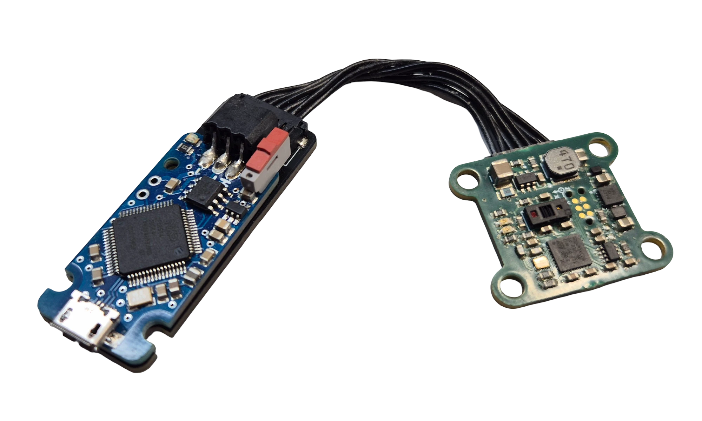<br>
A USBtingo CAN FD to USB adapter with one minipanel sensor board.
</div>

## 4 Connecting the Sensor Ring

The sensor boards of the Sensor Ring are daisy chained together with **Molex Pico-Lock 7-Pin** off-the-shelf cables.
The chain of sensors needs to be terminated at one one by a RaspberryPi with the EduArt adapter shield or by a computer with a CAN FD to USB adapter.

> ℹ️ The connectors on the boards have no dedicated input or output and can be joined in any order and orientation.

<div align="center">
<table style="border: none;">
<tr>
	<td style="text-align:center">
		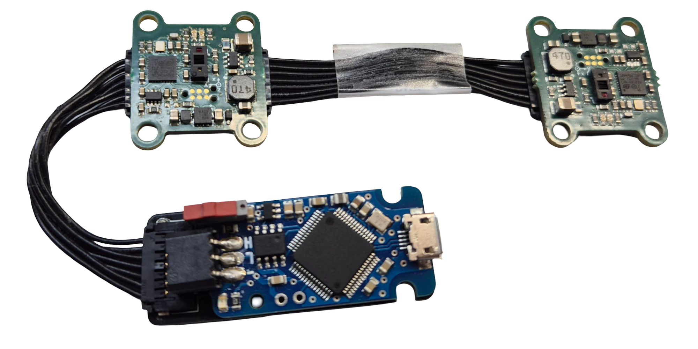<br>
		Top view of a sensor chain with two minipanels and an USBtingo as adapter.
	</td>
	<td style="text-align:center">
		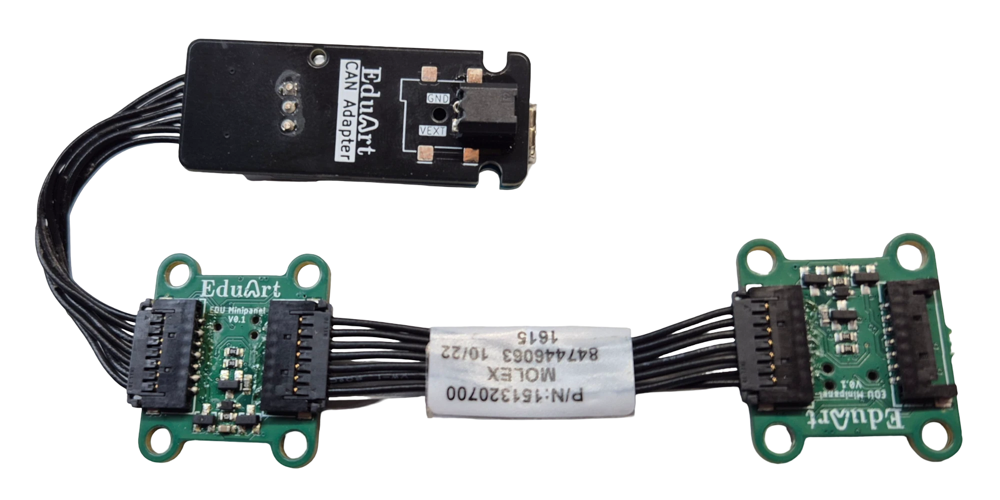<br>
		Bottom view of a sensor chain with two minipanels and an USBtingo as adapter.
	</td>
</tr>
</table>
</div>


<div class="section_buttons"> 

| Read Previous | Read Next |
|:--|--:|
| [Readme](../../README.md) | [Installation](02_installation.md) |

</div>